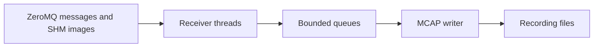

# MCAP Bagger

Standalone recording of opaque ZeroMQ payloads and shared-memory images.

## Overview

MCAP Bagger records local publisher streams into MCAP files for later inspection.
It is intended for developers collecting telemetry and camera data. No sibling
project packages are required.

## Features

- Record opaque messages and raw or JPEG shared-memory images.
- Control recordings through a web server with downloads and deletion controls.
- Publish demo streams, summarize recordings, and preview files in a desktop player.

## Architecture

`main.py` selects application operations from structured arguments parsed by
`cli.py`. The pipeline receives messages and images, and the writer stores MCAP.
The server owns recording lifecycle controls; the desktop player reads files.



Message and image threads feed independent queues, each limited to 64 MiB and
4,096 entries. One writer alternates between queues. Overflow stops the run.
Ctrl+C or SIGTERM stops producers and drains accepted entries before finalizing.
Failures retain `.mcap.partial`; successful files use `.mcap` without overwrite.

Optional `sync_interval_s` defaults to 0 (disabled). A positive value periodically
finishes buffered MCAP chunks and fsyncs dirty data, even during idle traffic.
The sample uses 1 second. Shutdown always syncs. Sync failures stop recording.
Periodic syncing reduces unsynced data loss but does not guarantee a finalized
MCAP after a crash. Disk stalls can increase queue pressure. JPEG is lossy.

## Requirements

**Software**

- Python 3.12+ and uv; the development workflow uses Python 3.12.
- Dependencies declared in `pyproject.toml`, installed by uv.
- A desktop display and Tkinter for the optional player. Install missing Tkinter
  manually; the Ubuntu package is `python3-tk`.

**Hardware**

No specific board or sensor is required for the synthetic demo.

## Installation

```bash
git clone https://github.com/robobe/mcap_bagger.git
cd mcap_bagger
uv sync --locked
```

Build the wheel with `uv build --wheel --out-dir dist`.
The result is in `dist/` and includes the web UI (`mcap_bagger/web.html`) and
example configuration (`mcap_bagger/config/recorder.yaml`). Copy the packaged
configuration to a writable location before editing it or recording.

## Quick Start

Print the default YAML with `mcap-bagger default-config`, or save it using shell
redirection:

```bash
uv run --locked mcap-bagger default-config > recorder.yaml
```

Edit the saved config before use. `output_dir` is relative to its location;
the default `../recordings` writes to the parent directory's `recordings/` folder.

```bash
uv sync --locked
uv run --locked mcap-bagger version
uv run --locked mcap-bagger run --config config/recorder.yaml
uv run --locked pytest -q
```

With publishers running, the recorder writes into the configured output directory.
Stop with Ctrl+C to drain accepted data and finalize the recording.

## Usage

The old interactive CLI, implicit simulation mode, legacy YAML, flight report,
and legacy output/readiness options have been retired. Use `run --config` and
set output location in YAML. `register_channels` remains a Python helper for
creating registration-only files. Automated tests cover the standalone pipeline.

### Ten-second publishing example

```bash
uv run --locked python examples/run_demo.py --config config/recorder.yaml
uv run --locked python examples/summarize_mcap.py recordings/<printed-file>.mcap
```

The demo starts the recorder after binding publishers and waits for subscriptions.
It publishes changing 640x480 RGB8 SHM images at 30 FPS, synthetic IMU at 100 Hz,
and camera_info at 1 Hz for ten seconds. It keeps SHM alive until recorder
shutdown. Configured image compression is applied by the recorder. Existing
recordings are preserved; busy endpoints cause failure rather than replacement.
The summary counts all configured channels and computes observed rates from
MCAP receive timestamps using (count-1)/(last-first). Single-message and empty
channels show N/A. Both scripts accept `version` and `--help`.

### Recording server

```bash
uv run --locked mcap-bagger server --config config/recorder.yaml --host 0.0.0.0 --port 9090
```

Open `http://<recorder-machine-ip>:9090` from a machine on your trusted LAN.
There is no authentication: anyone who can reach the server can control and
remove inactive recordings. Run one server worker; remote HTTP access does not
change the loopback-only ZeroMQ configuration. The YAML is fixed at startup.

Enter a filename stem (1–64 letters, digits, underscores or hyphens), optionally
ending in `.mcap`, then Start. Stop drains queues and finalizes the file. Existing
names are never overwritten. Only one recording can run at a time. The page
lists completed and partial recordings and supports downloads, individual Delete,
and Clear all inactive, with deletion confirmation. Active files are protected.
Partial downloads may require MCAP recovery tools. All operations stay inside
the configured output directory and reject symlinks. Server shutdown stops and
finalizes any active session. A VS Code “Web server” task is included.

The API exposes `/api/status`, `/api/recordings`, POST
`/api/recordings/start` with `{"filename":"test_run"}`, POST
`/api/recordings/stop`, GET `/api/recordings/{name}/download`, and DELETE
`/api/recordings/{name}` or `/api/recordings`. FastAPI's `/docs` describes requests.

To publish the same streams without starting a recorder (for example, while
using the server controls), run:

```bash
uv run --locked python examples/run_demo.py --config config/recorder.yaml --publish-only
```

Publication starts immediately and lasts ten seconds, even with no subscribers.
The script does not start or stop an independently running recorder.

### Desktop test player

Run `uv run --locked mcap-bagger player`. Load a finalized MCAP using the native
file picker. Start plays at recorded speed; Stop pauses; Step advances to the
next image while updating intervening text topics. Start resumes, or restarts
at EOF. JPEG previews are self-contained; raw previews require previously
encountered camera_info with width, height, step, and rgb8/bgr8 encoding.
Ordinary payloads appear as JSON, text, or hex, truncated at 16 KiB per topic.
This is a simple test viewer with no seeking or editing. Tkinter must be installed
manually if absent (Ubuntu package: `python3-tk`); a desktop display is required.

## Configuration

YAML declares a project, output directory, and channels with `topic`, `endpoint`,
and boolean `shm`. Endpoints use loopback TCP. Output paths are relative to YAML.
Ordinary messages contain two ZeroMQ frames (topic and payload); payload bytes
are preserved, including binary and empty data. Image notifications use the
existing local SHM descriptor/header protocol. `compress: raw` preserves pixels;
`compress: jpeg` encodes JPEG at quality 90. The publisher supplies `camera_info`
as an ordinary opaque channel. No companion metadata channel is generated.

See [the example configuration](config/recorder.yaml). `sync_interval_s` defaults
to 0 (disabled); the example sets 1 second. Configure project and output location
in YAML before starting a recording.

## Project Structure

```text
mcap_bagger/
├── src/mcap_bagger/  # CLI, pipeline, writer, server, and player
├── tests/           # Automated checks
├── config/          # Example recorder configuration
├── docs/plans/      # Implementation plans
├── examples/        # Publishers and MCAP summary
└── README.md
```

## Development

Use Python 3.12 and `uv sync --locked`. Build with `uv build --wheel --out-dir dist`.
Use **Terminal → Run Task** in VS Code. Choose **Web server** to run the recording server.
Choose **MCAP player** (debug icon) to launch `uv run --locked mcap-bagger player`.
The icon identifies the task; it does not attach a debugger.
The **Tests** task opens a selection menu for demo publishing, demo recording,
MCAP summaries, or the desktop player. Selecting MCAP summary prompts for its
file path in the terminal; enter it without surrounding quotes. The task is
also available through VS Code’s test task group.
No formatter, linter, or debugger configuration is specified.

## Testing

```bash
uv run --locked pytest -q
```

Tests cover configuration, CLI, lifecycle, transports, MCAP readback, server,
examples, and player behavior.

## Documentation

- [Repository guidelines](AGENTS.md)
- [Implementation plans](docs/plans/)
- The running recording server exposes API documentation at `/docs`.

## Troubleshooting

### Busy publisher endpoints

The demo fails when configured endpoints are busy. Stop the conflicting publisher
or select unused loopback endpoints in the configuration.

### Missing desktop support

The player requires a desktop display and Tkinter. Install Tkinter manually if
missing; on Ubuntu the package is `python3-tk`.

### Partial recordings

Failures retain `.mcap.partial` files. These may require MCAP recovery tools;
periodic syncing does not guarantee a finalized recording after a crash.

## Roadmap

Future commitments are unspecified.

## Contributing

Report issues and propose changes through the repository's GitHub project.
Keep changes focused, use short imperative commit subjects, and describe the
problem, changes, and validation in pull requests, including checks not run.

## License

A project license is unspecified; no LICENSE file is currently provided.
