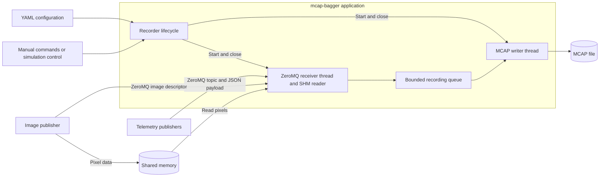
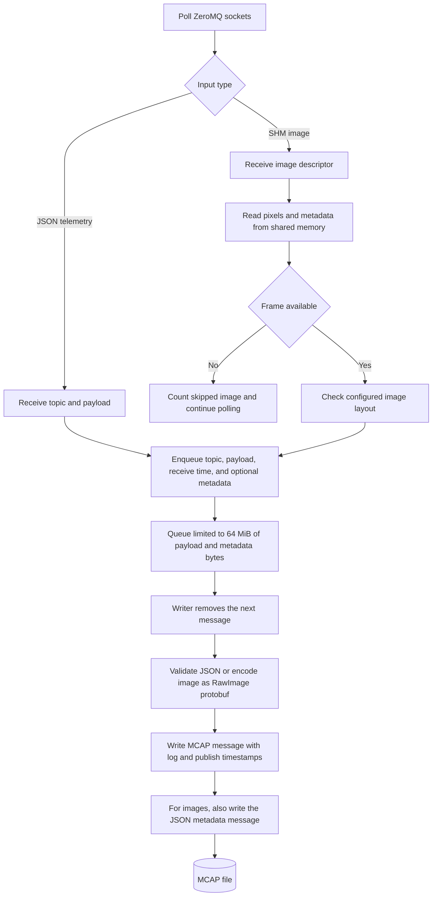

# Recording data flow

The application records JSON telemetry and shared-memory images in an MCAP file.
ZeroMQ carries telemetry payloads and image descriptors. Image pixels are read
from shared memory. A bounded queue connects the receiver thread to a single
writer thread, which validates and encodes each message before writing it.

## Application block diagram

## Startup

1. Load and validate the configuration, including topics, schemas, transport
   endpoints, and image layouts.
2. Create a new `.mcap.partial` file and register the MCAP schemas and channels.
   Each image topic also has a JSON metadata channel named `<topic>/metadata`.
3. Start the receiver thread. It creates ZeroMQ SUB sockets, installs topic
   subscriptions, connects to the configured endpoints, and registers the
   sockets with a poller. Image topics also have shared-memory readers.
4. Once the receiver is ready, start the writer thread.

## Message data flow

The receiver checks message framing and routes messages to configured topics.
For images, it reads the shared-memory frame and checks that its width, height,
encoding, and row stride match the configuration. An unavailable frame is
counted as skipped.

Each queue entry contains the topic configuration, payload bytes, receive
timestamp, and optional image metadata bytes. The queue holds at most 64 MiB
of payload and metadata bytes. An overflow fails the recording and stops it
from accepting new messages.

The writer processes queue entries in order. It validates JSON telemetry
against the configured schema and preserves its payload bytes. It converts
image pixels to Foxglove `RawImage` protobuf messages and writes the original
image metadata to the companion metadata channel.

## Timestamps

All MCAP timestamps are in nanoseconds. Each message uses its receive timestamp
as `log_time`. The `publish_time` depends on the topic configuration:

| Input | Publish timestamp |
| --- | --- |
| JSON with `timestamp_source: receive` | Receive timestamp |
| JSON with `timestamp_source: publisher` | Top-level `timestamp_ns` in the JSON payload, validated as a positive unsigned 64-bit integer |
| SHM image | Receive timestamp, also stored in the `RawImage` timestamp |

The recorder does not automatically select a timestamp from a message header.
Image metadata messages use the image's receive timestamp for both MCAP
timestamps and include the image record's sequence number for correlation.

## Shutdown and failures

On close, the recorder stops accepting messages, disconnects the receiver,
and drains the queued messages. It then writes `recording_health` metadata,
finishes the MCAP file, flushes it, and synchronizes it to disk. A successful
recording is published with the `.mcap` extension without replacing an existing
file.

Receive errors, invalid messages, queue overflow, and write or finalization
errors mark the recording as incomplete. Failed recordings retain the
`.mcap.partial` extension. The recorder attempts finalization, but a write or
finalization failure can leave the file without a complete MCAP footer or
health metadata.
