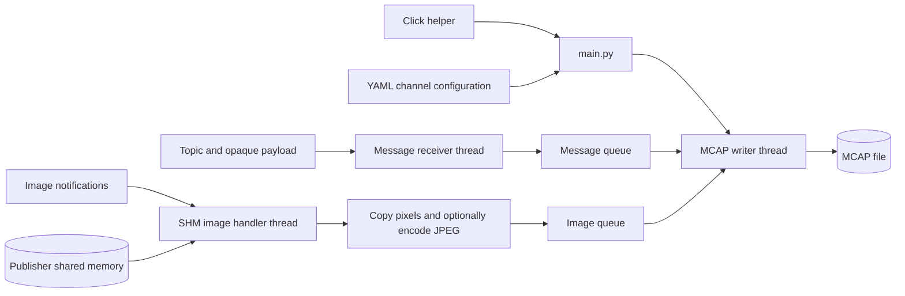

# Recording data flow

`main.py` dispatches commands parsed by the Click helper. `run --config` loads
channel declarations and starts a writer thread and two receiver threads.

The writer registers configured channels without payload schemas. Ordinary
payloads are stored unchanged. Image notifications follow the existing local
publisher protocol; the image handler validates descriptors and SHM headers,
copies pixels under a shared lock, and releases the lock before JPEG encoding.
`compress: raw` preserves pixels; `compress: jpeg` uses quality 90.

Each queue holds at most 64 MiB of payload bytes and 4,096 entries. Overflow
fails the run. The writer alternates between available queues, preserving each
queue's FIFO order without promising global timestamp order. Both MCAP
timestamps use local receive time. Channels retain transport and compression
settings as MCAP metadata. `camera_info` is publisher-provided and opaque;
no companion metadata channel is generated.

On interruption, producers stop and the writer drains accepted entries before
finalizing and syncing the file. Only successful recordings are published as
`.mcap`, without replacing an existing file. Failed recordings retain
`.mcap.partial`. Unavailable, stale, or busy SHM frames are counted as skipped;
malformed descriptors, unsafe SHM files, encoding failures, and write errors
stop recording. Raw image interpretation belongs to consumers of camera_info.

## Writer ownership and shutdown

`McapWriter` in `writer.py` owns the stream and MCAP operations. Its `start()`
waits for channel registration before Pipeline starts receivers. SharedQueues
provides bounded enqueue, blocking alternating dequeue, and input closure.
No queue lock is held during file writes.

Pipeline stops and joins producers before calling `finish()`. Closing queue
input wakes the writer, which drains accepted entries and finalizes the file.
Producer errors retain a finalized partial file. A writer error closes queue
input and the stream without retrying or attempting an MCAP footer; Pipeline
then stops producers. Completion and readiness events also fire on failure.

## Periodic disk sync

Optional `sync_interval_s` defaults to zero. Positive intervals use monotonic
writer deadlines and timed queue waits. Dirty MCAP chunks are flushed and the
file is fsynced even when no new messages arrive. Clean intervals do no disk
work. Final shutdown always syncs, and sync failures retain a partial file.
