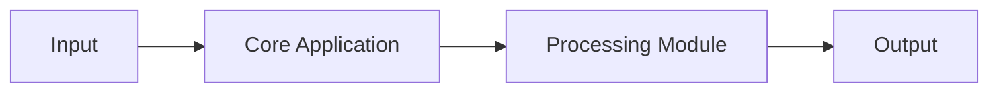

# Project-local README maintenance skill

## Summary

Create `$maintain-readme`, add Codex event guidance to AGENTS.md, and restructure
the current README using the embedded template.

## Implementation and usage

- Store the skill in `.agents/skills/maintain-readme/` with the template in
  `references/readme-template.md`; do not depend on the original guide.
- Manual invocation reviews the whole README unless a change is specified.
- Trigger during Codex work after version, feature/removal, CLI/API/config,
  installation/dependency, architecture, and build/test workflow changes.
- Review after implementation and validation, before reporting completion.
  Skip internal-only refactors and leave accurate documentation unchanged.
- Preserve useful content, main heading order, and operational limitations.
  Verify claims against repository evidence; mark unknown facts as unspecified.
- Edit only the root README during maintenance. Keep implicit invocation enabled.
  Add no dependencies, Git hooks, CI jobs, or background listeners.

## Validation

Run the skill validator and check headings, commands, and local links.
Check manual review, version changes, user-facing behavior changes, and internal
refactors. Application tests are unnecessary for documentation-only edits.
Codex triggers rely on instruction following and do not monitor outside edits.

## Reference template

````markdown
# Project Name

Short description of the project in 1–2 sentences.

## Overview

Explain:
- What problem does this project solve?
- What is its main purpose?
- Who is it intended for?

## Features

- Feature 1 — Description
- Feature 2 — Description
- Feature 3 — Description

## Architecture

Describe the main software components and their responsibilities.



## Requirements

**Software**
- Operating system: Ubuntu 24.04
- Python 3.12+ or Rust stable
- Required libraries and tools

**Hardware (if applicable)**
- Supported boards or devices
- Sensors and interfaces

## Installation

Clone the repository:

```bash
git clone https://github.com/USER/PROJECT.git
cd PROJECT
```

Install dependencies:

```bash
# Add project-specific installation commands
```

## Quick Start

Run the minimal example:

```bash
# Add command to start the application
```

Expected result:

Describe what should happen when the application runs successfully.

## Usage

Explain common workflows and commands.

### Example 1: Basic usage

```bash
# Example command
```

### Example 2: Advanced usage

```bash
# Example command
```

## Configuration

Describe configuration files and options.

| Parameter | Default | Description |
|---|---|---|
| `log_level` | INFO | Logging verbosity |
| `port` | 8080 | Application port |
| `debug` | false | Enable debug mode |

## Project Structure

```text
project/
├── src/             # Source code
├── tests/           # Automated tests
├── config/          # Configuration
├── docs/            # Documentation
├── examples/        # Usage examples
├── README.md
└── LICENSE
```

## Development

Explain how to set up the development environment.

Include:
- Build instructions
- Code formatting
- Static analysis and linting
- Debugging

## Testing

Explain how to execute automated tests.

```bash
# Add test command
```

## Documentation

Additional documentation:

- [Architecture](docs/architecture.md)
- [Development Guide](docs/development.md)
- [API Reference](docs/api.md)

## Troubleshooting

### Common issue 1

**Problem:** Describe the error.

**Solution:** Explain how to fix it.

## Roadmap

- [ ] Planned feature 1
- [ ] Planned feature 2
- [ ] Planned feature 3

## Contributing

Explain how to report issues, propose changes, and submit pull requests.

## License

Specify the license for this project and link to the LICENSE file.
````
